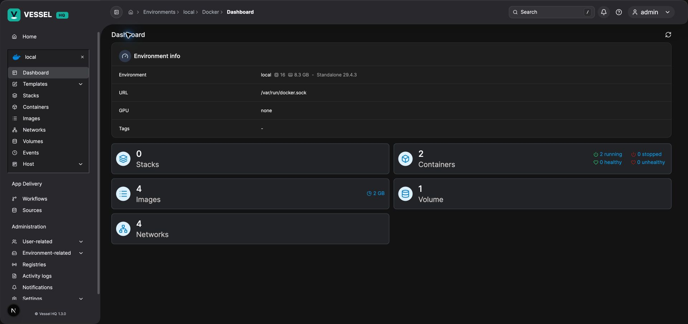

<p align="center">
  <picture>
    <source media="(prefers-color-scheme: dark)" srcset="./web-src/public/images/vessel-hq-logo.svg" />
    
  </picture>
</p>

<p align="center">
  <a href="https://github.com/TheModCraft-TMC/Vessel-HQ/releases/latest"></a>
  <a href="https://github.com/portainer/portainer"></a>
  
  
</p>



Vessel HQ is TheModCraft's independently maintained fork of Portainer Community Edition: a container management console for Docker, Docker Swarm, Podman, Kubernetes, and Azure Container Instances, with a homelab-first product direction.

The project combines Portainer's Go API with a Next.js/React console and maintained GitOps, Vault, access-control, registry, audit, and realtime features. The frontend follows explicit core, domain, provider, and UI boundaries; see the migration summary for verification details.

The frontend migration was built using GPT-5.6 Sol agents exclusively. Local frontend development now uses Turbopack; production builds currently use webpack.

## Project identity

- Repository: [TheModCraft-TMC/Vessel-HQ](https://github.com/TheModCraft-TMC/Vessel-HQ).
- Vessel release version: [RELEASE_VERSION](./RELEASE_VERSION).
- Upstream API and datastore compatibility baseline: **Portainer 2.45.0**, separate from the Vessel release number.
- Vessel images: [themodcrafttmc/vessel-hq](https://hub.docker.com/r/themodcrafttmc/vessel-hq), also mirrored at `ghcr.io/themodcraft-tmc/vessel-hq`. Preview releases use the `beta` channel; stable releases use `latest`. Historical images remain at [themodcrafttmc/portainer](https://hub.docker.com/r/themodcrafttmc/portainer).

Vessel HQ is a community fork, not Portainer Business Edition. Future capabilities are documented separately from implemented behavior.

## What the fork adds

- GitOps source/workflow improvements, force redeployment, and relative-path volume handling.
- Vault deployment secrets, token validation, renewal, and internal-address fallback.
- Custom roles, Authentik group synchronization, effective-access visibility, and per-stack read-only sharing.
- GitHub Container Registry integration and authenticated repository/tag browsing.
- Persistent activity logs and export workflows.
- Cached overviews, authenticated realtime invalidation, live logs, and node metrics.
- Fork-aware version reporting and multi-architecture release tooling.

See the [feature catalog](./docs/recent-features/README.md) and [customization guide](./docs/themodcraft/README.md) for details and constraints.

## Local development

Prerequisites: Docker, Go 1.26.10, Node.js 24.21.0 or newer in the 24.x line, and pnpm 10.26.2. Keep Docker running for the local backend.

```sh
make deps
./launch-dev.sh
```

Default development URLs are `http://localhost:8999` for the frontend and `https://localhost:9443` for the backend. The development launcher can enable automatic login; use it only locally.

See [development setup](./docs/development-setup.md) for separate processes and configuration, and [release and deployment](./docs/themodcraft/release-and-deployment.md) and the [build guide](./docs/build-guide.md) for image builds and rollback.

## Source layout

```text
backend-src/                 Go API, authorization, datastore, runtime integrations
web-src/
  app/                       Next.js App Router routes and layouts
  core/                      composition, session, navigation, query, realtime
  domains/                   product workflows and public APIs
  providers/                 infrastructure and remote-system adapters
  shared/                    cross-domain contracts and utilities
  ui/                        reusable components, layouts, and tokens
scripts/                     development, packaging, architecture checks
docs/                        operations, decisions, plans, migration notes
```

The [domain/provider architecture](./docs/planning/frontend-domain-provider-architecture.md) defines ownership. The [frontend architecture guide](./docs/planning/frontend-architecture.md) describes enforcement.

## Frontend verification

```sh
pnpm check:frontend-modernization
pnpm check:frontend-boundaries
pnpm check:app-router-compliance
pnpm typecheck
pnpm test
pnpm lint:ci
pnpm build
```

These are verification commands, not a claim that the current migration has passed them. Run backend tests appropriate to changed Go packages as well. See [verification guidance](./docs/themodcraft/verification.md).

## Generated API client

After changing Go Swagger annotations:

```sh
make generate-api
```

The pipeline produces `backend-src/api/docs/swagger.yaml`, then `backend-src/api/docs/openapi.yaml`, and generates the TypeScript client in `web-src/core/generated-api/portainer/`. Configuration lives in [openapi-ts.config.ts](./openapi-ts.config.ts). Do not edit generated files by hand; consume their SDK functions and types through the configured application API boundary.

## Documentation and future plans

- [Product and architecture roadmap](./docs/planning/vessel-hq-roadmap.md).
- [Experimental native extensions](./docs/native-extensions.md): whole-package upload, admin grants, protected multi-package builds, inline stack drawers, label-based Traefik routing, live Docker byte counters, and persistent notes. The [Go SDK workspace](./docs/extension-sdk-workspace.md) supports typed reads and extension-owned note writes through a shared mTLS TCP/Unix gateway, without per-stack published ports. Managed execution and production activation remain planned; see the [design](./docs/planning/plugin-system.md). The [prerelease guide](./docs/releases/native-extensions-prerelease.md) includes distribution instructions and the [upstream security review](./docs/security/upstream-2026-10-16.md).
- [Migration changes and draft commit message](./docs/planning/migration-change-summary.md): dated migration, beta publication and verification record.
- [Planning backlog](./docs/planning/README.md).
- [Maintainer patch guide](./docs/maintainer-patches/README.md).
- [Vault integration](./docs/vault-integration/README.md).

## Contributing and security

Report fork bugs and feature requests in the [Vessel HQ issue tracker](https://github.com/TheModCraft-TMC/Vessel-HQ/issues). Read [CONTRIBUTING.md](./CONTRIBUTING.md) and [SECURITY.md](./SECURITY.md) for contributor and vulnerability-reporting guidance. [Upstream documentation](https://docs.portainer.io/) remains useful for shared concepts; fork-specific behavior is documented here.

## License and attribution

Vessel HQ derives from Portainer Community Edition and retains its zlib license. See [LICENSE](./LICENSE) and [ATTRIBUTIONS.md](./ATTRIBUTIONS.md).
